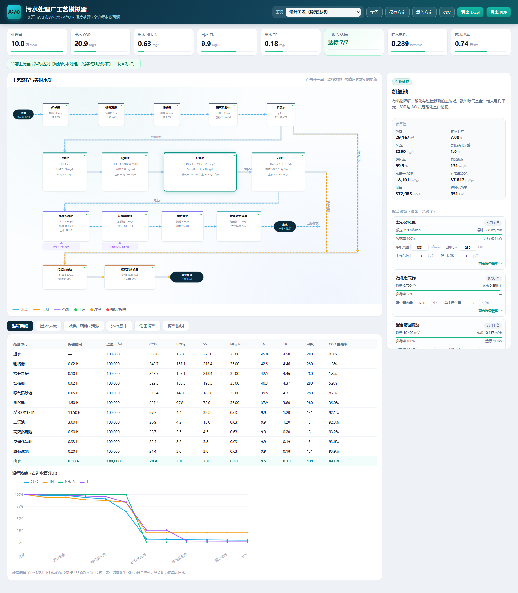
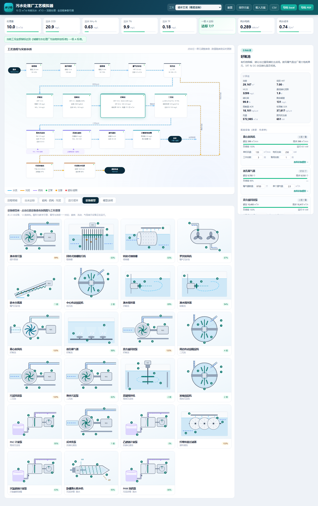
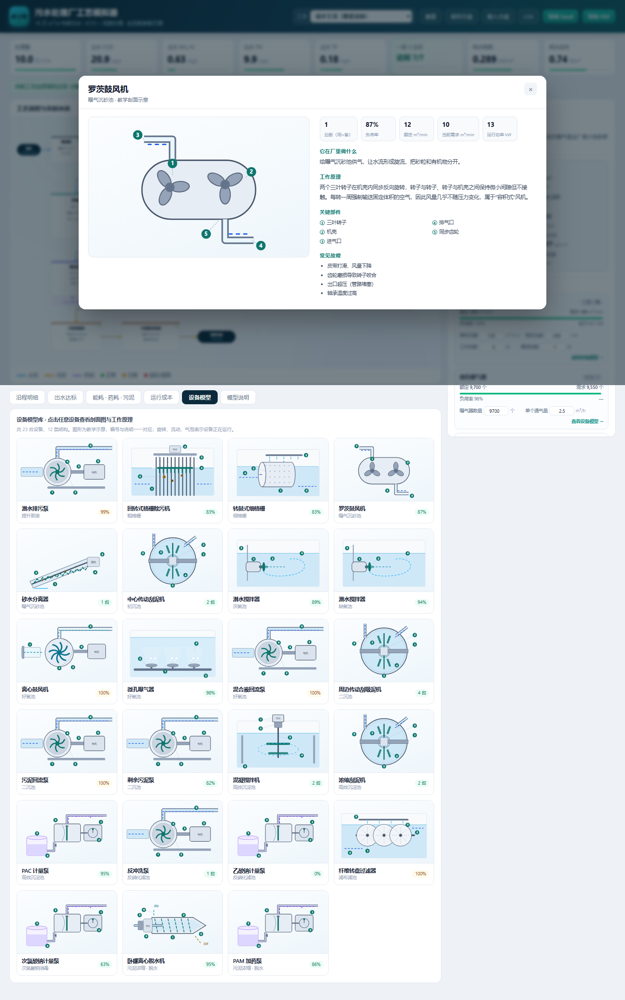

# 污水处理厂 A²/O 工艺模拟器

一个可以离线运行、也可以直接投屏讲课的**城市污水处理厂全流程模拟器**。
按 10 万 m³/d 典型市政污水标定，覆盖从进水到出水的完整工艺链，以及 23 台主要设备的剖面模型。

**在线使用：** 打开 Pages 地址即可（见仓库 About 里的链接），无需安装任何东西。



---

## 功能

### 1. 全流程工艺模拟

进水 → 粗格栅 → 提升泵房 → 细格栅 → 曝气沉砂池 → 初沉池 → 厌氧 / 缺氧 / 好氧 →
二沉池 → 高效沉淀池 → 反硝化滤池 → 滤布滤池 → 次氯酸钠消毒 → 出水，另含污泥浓缩、脱水、泥饼线。

- 18 个工艺节点、16 个单元、79 个工艺参数全部可调
- 改动任一参数，全厂物料平衡、出水水质、能耗、药耗、污泥量、吨水成本实时重算
- 顶部 8 个 KPI：处理量、出水 COD / 氨氮 / 总氮 / 总磷、一级 A 达标、吨水电耗、吨水成本

### 2. 设备层（选型与负荷率）

23 类主要设备（泵、鼓风机、格栅机、搅拌器、刮泥机、脱水机、计量泵等）挂到对应单元：

- 每台设备有额定流量/风量、电机功率、工作台数、备用台数
- 系统按工艺需求自动核算**负荷率**：低于 40% 提示"选型偏大"，高于 102% 提示"能力不足"
- 设备超载时流程图节点直接变红，不用点进去就能看见



### 3. 设备模型库（教学用）

13 类结构、23 台设备的剖面示意图，带旋转 / 流动 / 气泡动画：

- 图上 ①②③ 编号与右侧部件说明一一对应
- 每台设备配：它在厂里做什么、工作原理、关键部件、常见故障
- 弹窗顶部显示该设备在**当前工况**下的台数、负荷率、额定与需求、运行功率



### 4. 工况与导出

- 11 个预设工况：设计工况、冬季 12℃、冬季优化、雨季冲击、工业废水偷排、春节低负荷、
  碳源不足、投碳源恢复、初沉池超越、曝气不足、超负荷 130%
- 导出 Excel（真 .xlsx，5 张工作表：沿程明细 / 出水达标 / 能耗与污泥 / 设备清单 / 参数表）
- 导出 PDF（浏览器打印，含 6 节运行报告）
- 导出 CSV、保存/载入参数方案（JSON）

---

## 模型说明（重要）

这是一个**工程级教学 / 方案比选模型**，不是设计软件，也没有用某座具体污水厂的实测数据标定过。

**计算逻辑：**

- 池容由「设计规模 × 设计 HRT」确定；改"实际处理量"只改负荷、不改池容，超负荷会真实反映在
  停留时间、固体负荷和出水 SS 上
- MLSS = SRT × 剩余污泥量 ÷ 生化池容积，与 SRT、进水负荷、初沉效果联动
- 硝化：按硝化菌比增长速率（温度 θ=1.072、DO 半饱和 0.5 mg/L、氨氮半饱和 1 mg/L）反算
  最低泥龄 SRTmin，实际 SRT/SRTmin 决定硝化完成度；碱度不足时自动限制硝化
- 反硝化：取「碳源限制能力」与「动力学能力（SDNR × MLSS × 缺氧池容积）」的较小值，
  同时受内回流比决定的理论下限约束；温度按 θ=1.06 修正
- 除磷：厌氧释磷量随进水 TP、HRT、厌氧区 DO 变化；回流污泥携带的硝态氮会抑制释磷；
  好氧段按 2.6 倍释磷量吸磷，剩余 TP 由 PAC 化学沉淀兜底
- 需氧量：AOR = 0.5×去除 COD + 4.57×硝化量 − 2.86×反硝化量，再按 α、β、水深、温度折算成
  标准氧 SOR，由氧转移效率反算风量与鼓风机功率
- 二沉池出水 SS 由实际表面负荷的立方项与固体负荷超限共同决定

**默认值取的是典型市政污水的常见范围**（COD 350、BOD 160、SS 220、NH₃-N 35、TN 45、TP 4.5），
算出的出水在一级 A 限值内，量级与真实 10 万 m³/d 厂一致（电耗约 0.29 kWh/m³、泥饼约 100 t/d、
吨水成本约 0.7 元）。参数变化的方向与灵敏度与教科书和设计手册一致。

**但它不等于任何一座真实污水厂的实测值。** 如果要用于实际工程判断，必须用目标厂
12 个月以上的进出水数据做参数率定；未率定前，单项指标的偏差可能达到 ±20%~40%，
总氮、总磷和污泥产量尤其敏感。

**建模简化：**

- 进水不含硝态氮，有机氮按 TN − NH₃-N 计；同化需氮按 0.045 kgN/kgDS 扣除
- 滤液回流按进水量比例带入 NH₃-N 150、COD 250、TP 20 mg/L 的负荷
- 电耗为单元估算值（泵扬程、风机风压、搅拌功率密度），不含厂区照明等细小项
- 化学污泥按 PAC 投加量的 0.35 倍干泥估算；泥饼按设定含水率折算
- 设备层只做选型校核（额定 vs 需求），不反算工艺；设备选小了会报警，但不会强行把水质算坏

---

## 本地运行

不需要服务器、不需要联网、没有外部依赖：

```
直接双击 index.html
```

或者任意静态服务器：

```bash
python -m http.server 8080
# 打开 http://localhost:8080
```

## 目录结构

```
index.html        单文件应用（含全部 JS/CSS，约 175 KB）
screenshots/      README 用的截图
.nojekyll         关闭 GitHub Pages 的 Jekyll 处理
```

源码（可编辑的 `engine.js` / `models.js` / `ui.js` / `template.html` / `build.js`）
不在此仓库中，需要可联系作者。

## 许可

代码与图形采用 MIT License，可自由用于教学与二次开发；
工艺参数与模型结果仅供参考，使用者对据此做出的工程决策自行负责。
